# 示例

本目录收录用本 skill 完整跑通的行程。每个示例都是一次真实的规划过程：计划源文件（`plan.geo.json`）记录行程本身，美术方向文件（`plan.art.json`）决定视觉风格，渲染出的成品页是单文件 HTML——图片全部内嵌，双击即开、零网络请求。想快速感受风格差异，直接从杭州青岛示例的七主题预览看起。

## hangzhou-qingdao-2026 — 杭州 → 青岛，5 天 4 晚

2026-10-26 至 10-30，双飞往返，青岛老城单基地，含崂山全天与啤酒博物馆线路。**同一份计划渲染了全部七种主题**，方便逐一对比审查：

| 文件 | 主题 | 一句话观感 |
|---|---|---|
| `trip-illustrated.html` | illustrated 插画版 | 水彩手账，每天一屏：时间轴 + 现场贴士 + 可折叠高德路线图（默认主题） |
| `trip-clay2.html` | clay 黏土版 | 黏土定格地景，连绵天空下一条路串起五天 |
| `trip-noir2.html` | noir 黑白版 | 夜间胶片卷轴，封面即剧照 |
| `trip-glass2.html` | glass 玻璃版 | 磨砂玻璃叠片与交叉淡出的照片幕 |
| `trip-journal.html` | journal 手记版 | 航空信封 + 拍立得 + 火漆印章的旅行手帐 |
| `trip-zine.html` | zine 杂志版 | 拼贴刊物：海报、撕边照片、条码刊号 |
| `trip-splash.html` | splash 闪屏版 | 游戏启动画面拉成的长卷，浮岛章节 |

配套交付物：`gates.ics`（行前清单日历，含提醒）、`trip.kml`（编号图钉，可导入 Organic Maps 离线使用）、`build_theme_art.py`（从插画版 art 块派生其余六种主题 art 块的参考脚本）。

### 七种主题对照：首屏 + 内页

同一行程、同一份计划，仅视觉语言不同。左列为封面首屏，右列为第 2 天「红瓦绿树」的内页时间轴（截图均为 2400×1500，存于 `screenshots/`）：

| 主题 | 首屏 | 内页（第 2 天） |
|---|:---:|:---:|
| **插画版**（默认）水彩手账，每天一屏 | 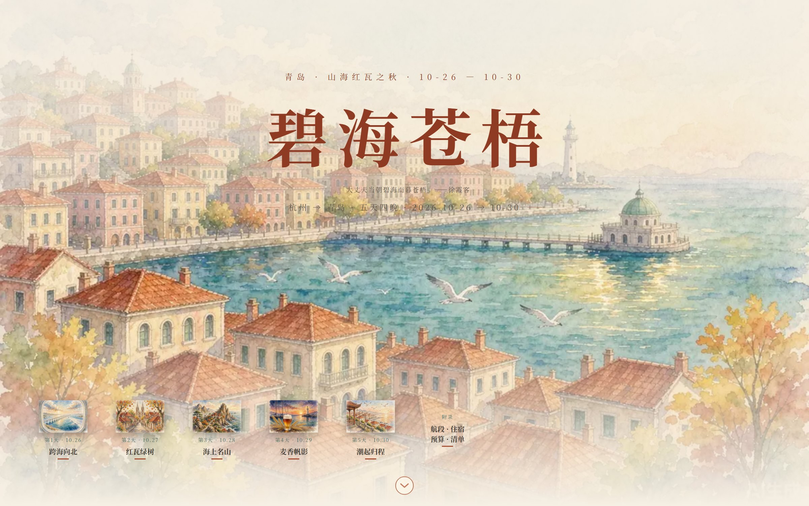 | 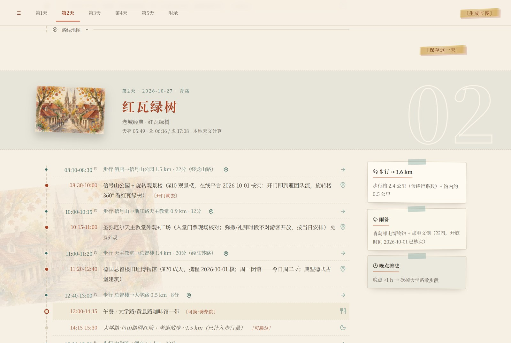 |
| **黏土版** 黏土定格地景，一条路串起五天 |  | 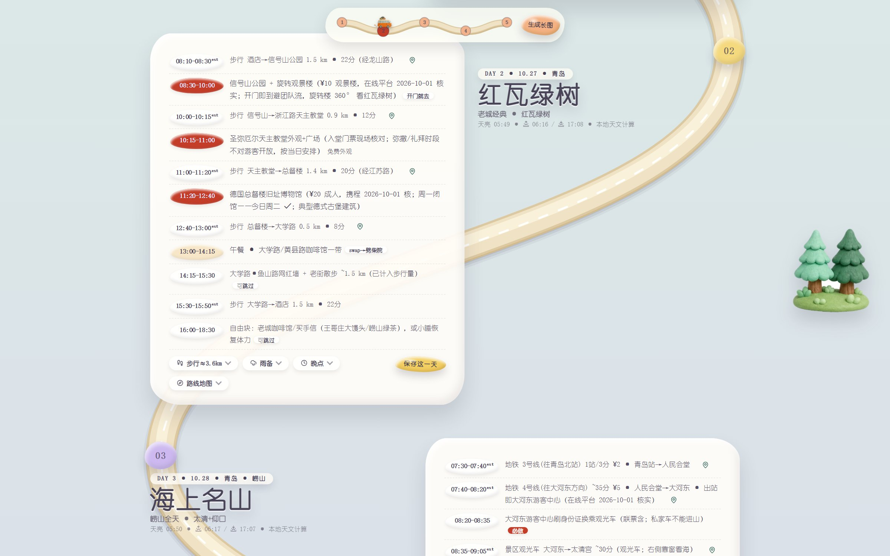 |
| **黑白胶片版** 夜间胶片卷轴，封面即剧照 |  |  |
| **玻璃版** 舷窗水彩之上浮一张磨砂玻璃卡片 |  | 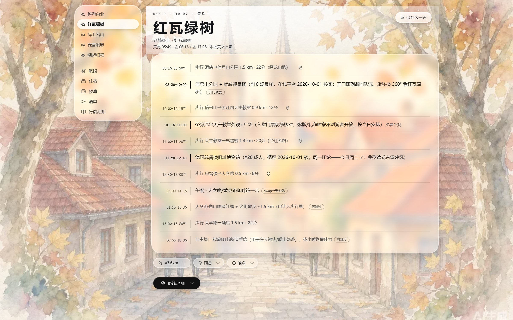 |
| **手记版** 航空信封 + 拍立得 + 火漆印章的旅行手帐 |  | 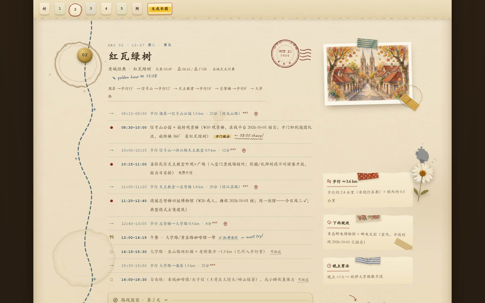 |
| **杂志版** riso 拼贴刊物：撕边海报与竖排刊名 | 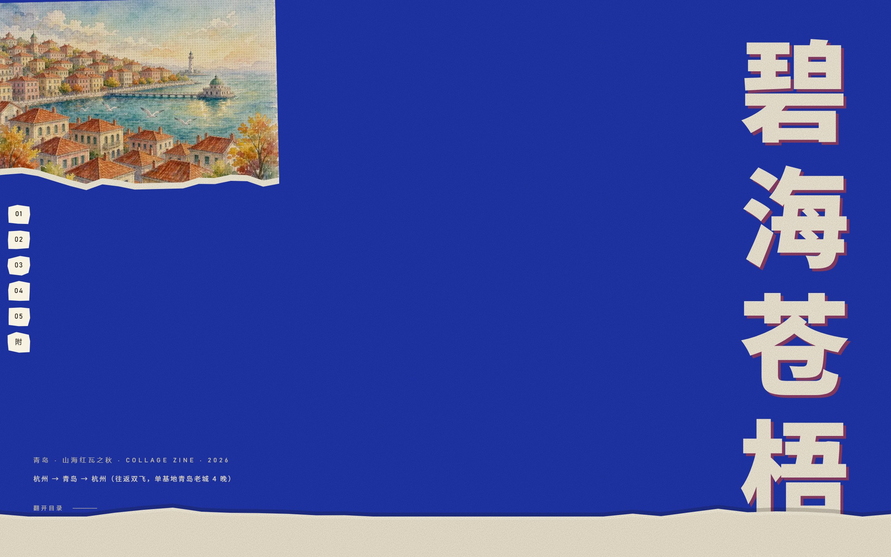 | 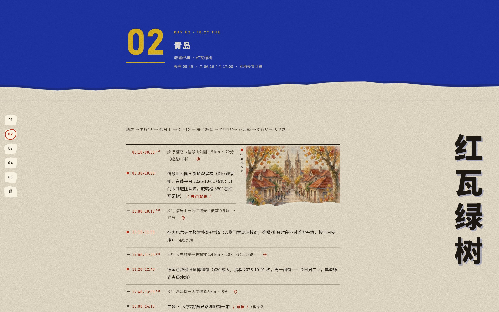 |
| **闪屏版** 游戏启动画面拉成的长卷，浮岛章节 |  |  |

### 插画版更多内页与门禁实测

| 每日一屏：崂山全天 | 行前清单（可导出 .ics） |
|:---:|:---:|
| 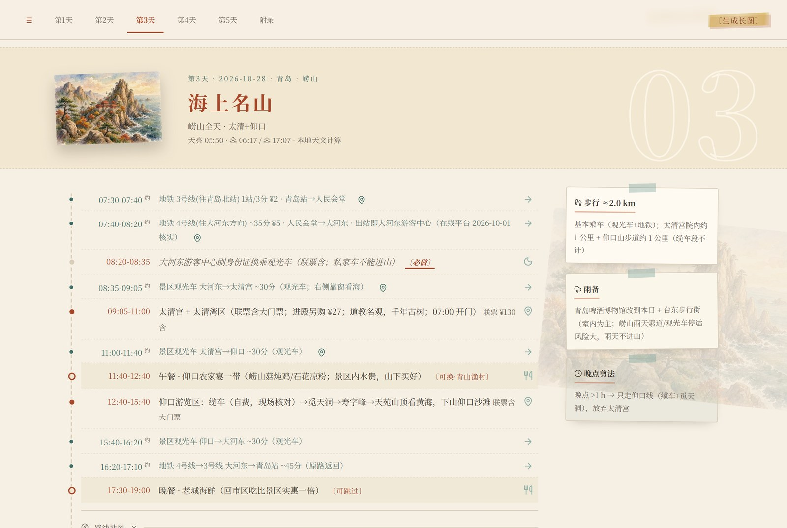 | 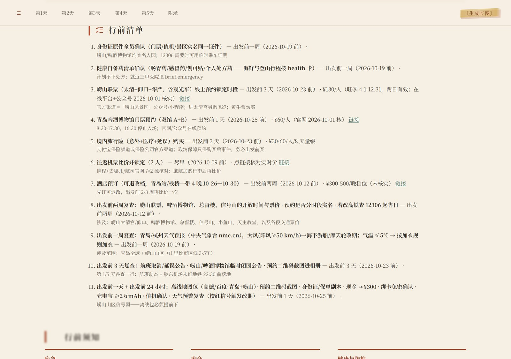 |

交付前门禁实测（`plan_lint` 内容门禁、`qc` 页面静态质检、`check --live` 高德实时时距核对的运行输出）：

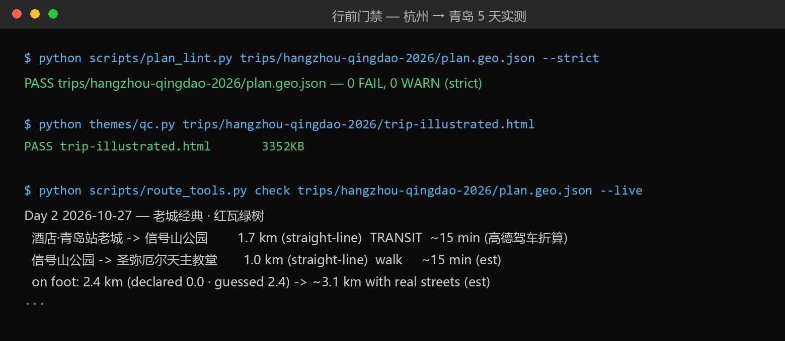

已知限制，供审查时参考：`splash` 的浮岛与载具贴纸需要透明的 cut-out 素材，本示例未生成，中央主视觉留空（天空、标题与路线均在）；`clay` 的黏土小人/标题贴纸同理未配置。

重新渲染任一主题（在本仓库根目录执行）：

```bash
python themes/render_theme2.py examples/hangzhou-qingdao-2026/plan.geo.json -o examples/hangzhou-qingdao-2026/trip-illustrated.html
python themes/render_clay2.py  examples/hangzhou-qingdao-2026/plan.geo.json -o examples/hangzhou-qingdao-2026/trip-clay2.html
python themes/render_noir2.py  examples/hangzhou-qingdao-2026/plan.geo.json -o examples/hangzhou-qingdao-2026/trip-noir2.html
python themes/render_glass2.py examples/hangzhou-qingdao-2026/plan.geo.json -o examples/hangzhou-qingdao-2026/trip-glass2.html
python themes/render_journal.py examples/hangzhou-qingdao-2026/plan.geo.json -o examples/hangzhou-qingdao-2026/trip-journal.html
python themes/render_zine.py   examples/hangzhou-qingdao-2026/plan.geo.json -o examples/hangzhou-qingdao-2026/trip-zine.html
python themes/render_splash.py examples/hangzhou-qingdao-2026/plan.geo.json -o examples/hangzhou-qingdao-2026/trip-splash.html
python themes/qc.py examples/hangzhou-qingdao-2026/trip-<theme>.html   # 退出码 0 即通过
```

注意：每日高德静态路线图在渲染时实时抓取并烙进页面，需要环境变量 `AMAP_KEY`；没有 key 时对应折叠块自动隐藏，页面其余部分不受影响。内容门禁：`python scripts/plan_lint.py examples/hangzhou-qingdao-2026/plan.geo.json --strict`（当前 0 FAIL 0 WARN）。

## chongqing-2026 — 重庆，4 天 3 晚（splash 主题示例）

2026-11-05 至 11-08，双飞往返，住解放碑：洪崖洞夜景、李子坝轻轨穿楼、长江索道、磁器口、南山一棵树。

| 首屏 | 内页（第 2 天） |
|:---:|:---:|
|  | 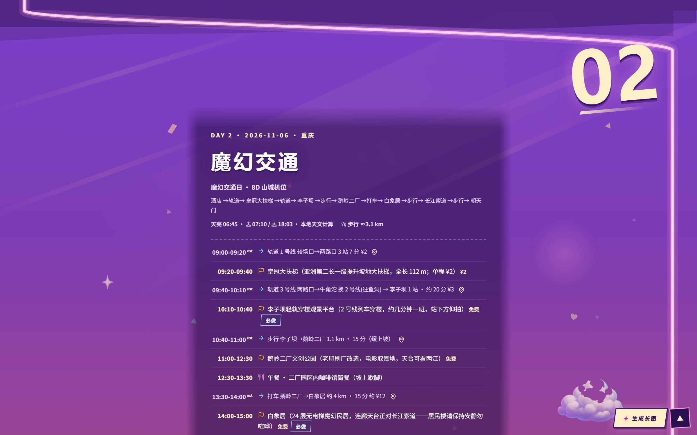 |
| 霓虹紫的夜空、热气球和一条串起四天的霓虹公路 | 轻轨穿楼、皇冠大扶梯——浮岛章节卡片里的 8D 山城 |

| 文件 | 说明 |
|---|---|
| `trip-splash.html` | splash 闪屏版成品页（霓虹紫调，霓虹公路串起四天） |
| `plan.geo.json` | 计划源文件（坐标来自高德 place/text 实查） |
| `plan.art.json` | 美术方向：kit 心情色板链（neon → dusk → alpine → sunrise → homebound） |
| `gates.ics` / `trip.kml` | 行前清单日历 / 离线地图 |

## shanghai-2026 — 上海周末，3 天 2 晚（zine 主题示例）

2026-11-13 至 11-15，高铁往返，住静安寺：愚园路、南京路、外滩、武康路—安福路—永康路、思南公馆、田子坊、豫园、苏州河。

| 首屏 | 内页（第 2 天） |
|:---:|:---:|
| 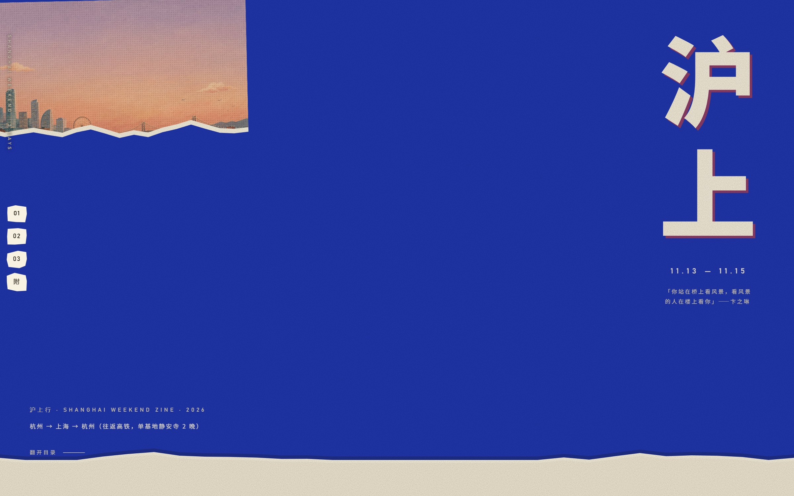 | 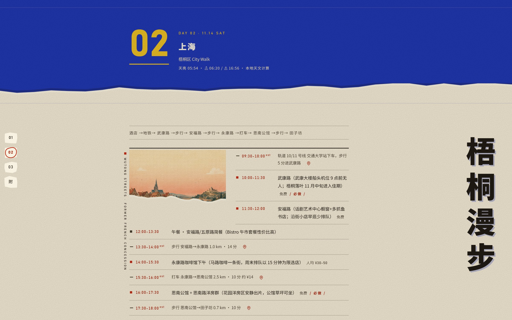 |
| riso 蓝撕边海报、竖排刊名、印刷网点 | 拼贴版式的时间轴——独立刊物气质配 city walk |

| 文件 | 说明 |
|---|---|
| `trip-zine.html` | zine 杂志版成品页（撕边海报、Kodak 印刷处理、竖排章节标题） |
| `plan.geo.json` | 计划源文件（坐标来自高德 place/text 实查） |
| `plan.art.json` | 美术方向：素材库海报画（天际线/老城/园林）+ 线稿 kit |
| `gates.ics` / `trip.kml` | 行前清单日历 / 离线地图 |

## china-2026 — 沪京西 8 天多城示例

上海 → 北京 → 西安 → 北京 → 上海，8 天，境内游客视角（身份证入园、12306 实名、景区预约）。同一份计划渲染了黏土与闪屏两种主题，是格式与新契约的活样板：

| 黏土版 | 闪屏版 |
|:---:|:---:|
|  |  |
| 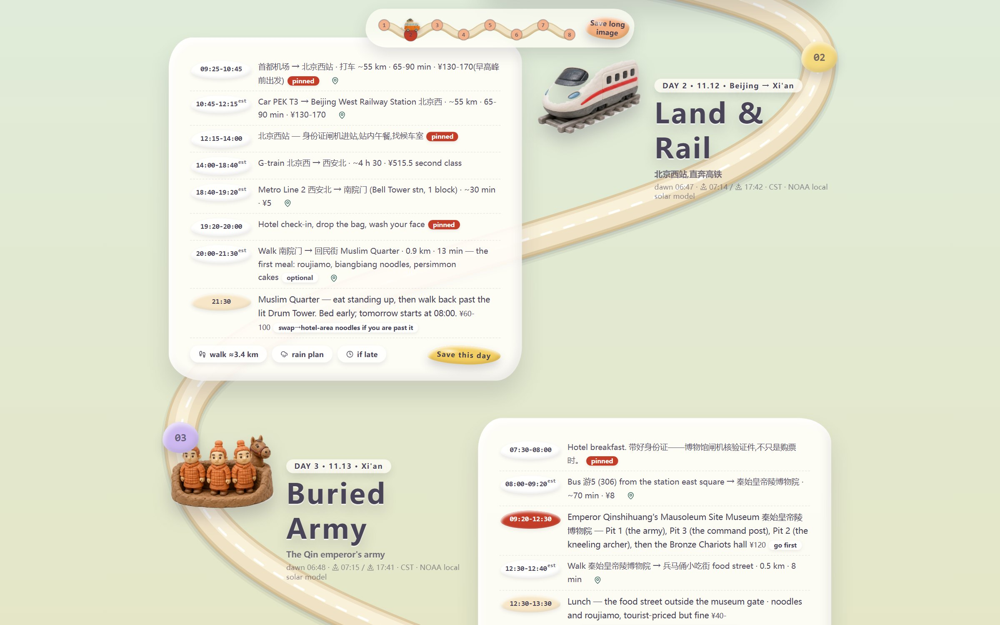 | 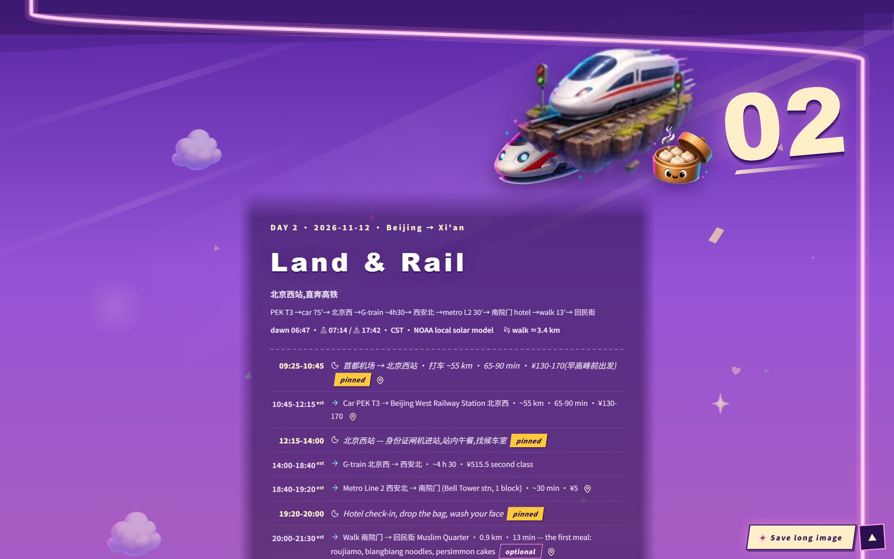 |
| 粉彩黏土云、热气球与越野小车，时间轴铺在奶油色卡片上 | 游戏化浮岛章节：高铁穿越、兵马俑与长城 |

| 文件 | 说明 |
|---|---|
| `china-2026/china.geo.json` | 计划源文件 |
| `china-2026/china.art.json` | 美术方向文件 |
| `china-2026/china-clay.html` | clay 黏土主题成品页 |
| `china-2026/china-splash.html` | splash 闪屏主题成品页 |
| `gates-sample.ics` | 行前清单日历样例 |

渲染命令：

```bash
python themes/render_clay2.py  examples/china-2026/china.geo.json -o china-clay.html
python themes/render_splash.py examples/china-2026/china.geo.json -o china-splash.html
python themes/qc.py china-clay.html
```

## 主题与行程的搭配参考

主题没有「只能配某种行程」的硬规则，但观感差异很大。选主题看两点：行程本身的气质（夜景都市 / 人文街区 / 自然风光），以及你想要的阅读感受。以上示例给出三种已被验证的搭配：

- **splash 闪屏版** × 高能量夜景都市（重庆）：大胆配色、霓虹光效与山城夜景互为映衬
- **zine 杂志版** × 都市漫步与人文街区（上海）：拼贴印刷感与街头漫步气质同频
- **illustrated 插画版** × 通用首选：水彩手账气质百搭，多城与自然系行程均稳

拿不准时，先看上面各示例的首屏截图——找到和你的行程气质最接近的那一种。

为 splash/zine 新行程渲染时需要显式带上素材库目录（图片内嵌依赖它）：

```bash
python themes/render_splash.py examples/chongqing-2026/plan.geo.json \
  -o examples/chongqing-2026/trip-splash.html --assets themes/assets/stock
python themes/render_zine.py examples/shanghai-2026/plan.geo.json \
  -o examples/shanghai-2026/trip-zine.html --assets themes/assets/stock
```

内容门禁（三个示例当前均 0 FAIL 0 WARN）：

```bash
python scripts/plan_lint.py examples/chongqing-2026/plan.geo.json --strict
python scripts/plan_lint.py examples/shanghai-2026/plan.geo.json --strict
```
